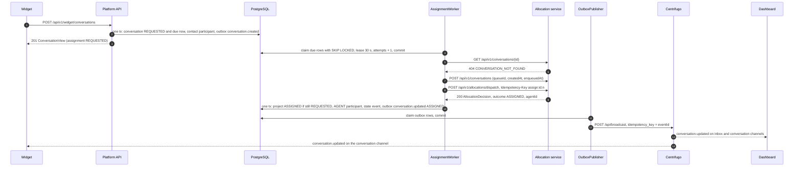

# Conversation platform: allocation service integration

Design document (master spec 11.1, 11.4, 13). Plan 04 implements it (`assignment` module, `AssignmentWorker`,
`/assign`, presence, Compose). Conventions (Existing, `D<n>`, `R<n>`): [system-overview.md](system-overview.md)
section 0. Decision record: [ADR-0009](../../specs/decisions/ADR-0009-allocation-service-integration.md). Engine facts,
the call table (ids S1 to S10, P1, P2, V1 to V4, A1 to A3, H1, O1 to O4) and the full failure matrix (F1 to F15) are in
[allocation-service-integration.md](../research/allocation-service-integration.md); read its section 1 ("what bites")
before changing anything here.

**Existing:** the platform has no allocation client today (`grep -rni allocation` over the platform finds nothing;
[workspace-inventory.md](../research/workspace-inventory.md) section 8.1, boundary 6); the demo hard-codes
`assigned_agent_id = agentbob`. The engine is a separate Maven project with its own PostgreSQL, REST under `/api/v1`,
header auth (`X-Tenant-Id`, `X-Role`, `Idempotency-Key`), a fixed-delay dispatch sweep and no Dockerfile.

## 1. Topology (D8)

| Container (Compose base file, Plan 04 T1) | Image | Host port → container | Key settings |
|---|---|---|---|
| `allocation-postgres` | `postgres:18.6-alpine3.24`, volume `allocation-postgres-data` | `127.0.0.1:5433` → 5432 (`ALLOCATION_DB_HOST_PORT`) | `POSTGRES_DB=allocation`, `POSTGRES_USER=allocation`, `POSTGRES_PASSWORD=${ALLOCATION_DB_PASSWORD}` (`__generate__` in `.env.example`); `pg_isready` health |
| `allocation-service` | `chat-platform/allocation-service:local`, built from `${ALLOCATION_ENGINE_DIR:-../RESEARCH/Allocationservice-research/allocation-engine}` with its new `Dockerfile` | `127.0.0.1:8081` → 8080 (`ALLOCATION_HOST_PORT`) | `ALLOCATION_DB_URL=jdbc:postgresql://allocation-postgres:5432/allocation`, `ALLOCATION_BIND_ADDRESS=0.0.0.0`, `ALLOCATION_FEATURE_LEVEL=operations`, `ALLOCATION_SEED_DEMO=false`, `ALLOCATION_DISPATCHER_ENABLED=true`, `ALLOCATION_DISPATCHER_DELAY=2s` (engine default 5 s), `ALLOCATION_UI_DIST=classpath:/static/`; depends on a healthy database; health `GET /actuator/health` |

- The engine is unchanged apart from an added `Dockerfile`, `.dockerignore` and one README line, uncommitted like the
  rest of that project (D8, D20). It runs its own Flyway V1 to V5 at start.
- The platform reaches it at `app.allocation.url` (`ALLOCATION_URL`): `http://localhost:8081` from the host,
  `http://allocation-service:8080` from containers; timeout `app.allocation.timeout=3s`.
- Feature level `operations` is required: claim, reassign and requeue answer 403 `FEATURE_DISABLED` below it.
- Demo seeding stays off: the engine's sweep covers every tenant, and a request without `X-Tenant-Id` silently falls back
  to `demo-tenant`.
- CI limitation: the `e2e` job runs only when the engine checkout exists as a sibling directory and otherwise reports
  the skip (Plan 04 T1).

Identifier mapping:

| Allocation concept | Platform value |
|---|---|
| tenant (`X-Tenant-Id`) | our tenant id |
| conversation id | our conversation UUID as text |
| queue id | `inboxes.allocation_queue_id` (seed: `support`) |
| agent id | our agent id (`agents.id`) |
| role (`X-Role`) | `operator`; `admin` for seeding |
| correlation (`X-Correlation-Id`) | the request or worker trace id |

There is no cross-service transaction. The platform's conversation row is the durable request; the allocation service
is the authority on assignments, availability and capacity; the platform stores a projection (D8).

## 2. Assignment of a new conversation

No allocation call happens inside a transaction or under a row lock: the claim commits first, the calls run, and the
projection is a new short transaction whose `UPDATE` carries an `assignment_state` precondition (0 rows: the row moved
on, the result is dropped; R13). The engine's own sweep may assign a waiting conversation without being asked and
without telling anyone, which is why the worker reads before it writes and polls `QUEUED` rows.

## 3. Worker algorithm per `assignment_state`

The state machine itself is in [domain-model.md](domain-model.md) section 6. `AssignmentWorker.runOnce()` claims a
bounded batch with `UPDATE conversations SET assignment_next_attempt_at = :now + :lease, assignment_attempts =
assignment_attempts + 1 WHERE id IN (SELECT id FROM conversations WHERE assignment_state IN ('REQUESTED','QUEUED',
'RELEASE_PENDING','REOPEN_PENDING') AND assignment_next_attempt_at <= :now ORDER BY assignment_next_attempt_at LIMIT
:limit FOR UPDATE SKIP LOCKED) RETURNING …` (index `ix_conversations_assignment_due`), then `AssignmentOrchestrator`
processes each row.

| Claimed state | Call | Allocation answer | New state (event) |
|---|---|---|---|
| `REQUESTED` | `findConversation` (V2) | absent | `createConversation` (V1; 409 `CONVERSATION_EXISTS`/`CONFLICT` = success) then `dispatch` (A1) → outcome table below |
| | | `QUEUED` | `dispatch` (A1) → outcome table |
| | | `ASSIGNED`, `ACCEPTED`, `ACTIVE` | `ASSIGNED`, agent from the record, `decisionId` null, reason `ALLOCATION_SWEEP` (event `ASSIGNED`) |
| | | `RESOLVED` | `requeueReopen` (V4), stays `REQUESTED`, due now |
| | | `CANCELLED` | `FAILED`, reason `ALLOCATION_CANCELLED` (event `ASSIGNMENT_FAILED`); the platform never cancels, so this is an alert |
| `QUEUED` | `findConversation` | `ASSIGNED`, `ACCEPTED`, `ACTIVE` | `ASSIGNED`, reason `ALLOCATION_SWEEP` (event `ASSIGNED`) |
| | | `QUEUED` | stays `QUEUED`, next poll in `queued-poll` (5 s); no dispatch, no event (D8 "`QUEUED` → poll") |
| | | absent | `REQUESTED` (the allocation side lost the record, F2: alert) |
| | | `RESOLVED` / `CANCELLED` | as for `REQUESTED` |
| `RELEASE_PENDING` | `resolve` (V3); 409 `CONVERSATION_CLOSED` and 404 `CONVERSATION_NOT_FOUND` count as done | done | `NONE`, agent and decision cleared (state event `RELEASED`, no realtime event) |
| `REOPEN_PENDING` | `findConversation` | absent | `REQUESTED` |
| | | `RESOLVED` | `requeueReopen` (V4 `{reason: REOPEN, excludePreviousAgent: false}`; 409 `INVALID_REQUEUE` with the record already `QUEUED` = done) → `REQUESTED` |
| | | `ASSIGNED`, `ACCEPTED`, `ACTIVE` (the release never reached the engine) | `ASSIGNED`, same agent, reason `REOPEN_KEPT_AGENT` (event `ASSIGNED`) |
| | | `QUEUED` | `QUEUED` (event `ASSIGNMENT_QUEUED`) |
| | | `CANCELLED` | `FAILED` |
| any | any call | `AllocationUnavailableException` (connect/read timeout, 5xx) | state unchanged, `next = Backoff.next(now, attempts − 1, poll-delay, max-backoff, rng)`; no event |
| any | any call | 404 `TENANT_NOT_FOUND`, 404 `QUEUE_NOT_FOUND`, 409 `NO_ACTIVE_POLICY` (allocation side not seeded yet) | state unchanged with backoff until the claimed `assignment_attempts ≥ max-setup-attempts` (30), then `FAILED` with that code (overview §7 B) |
| any | any call | any other 4xx (`FEATURE_DISABLED`, `IDEMPOTENCY_KEY_REUSED`, `INVALID_ID`, …) | `FAILED` with the code; logged at WARN |

Dispatch outcome table (A1; also used by `/assign`, section 5). Branch on `outcome`, never on HTTP 200:

| Outcome | Worker | `/assign` answer |
|---|---|---|
| `ASSIGNED` | `ASSIGNED`: agent, `decisionId`, reason, explanation (event `ASSIGNED`) | 200 view, `assignment.state = ASSIGNED` |
| `QUEUED_NO_ELIGIBLE_AGENT`, `QUEUED_CAPACITY_EXHAUSTED`, `QUEUED_NO_AVAILABLE_AGENT`, `QUEUED_MANUAL_SELECTION`, `QUEUED_FEATURE_DISABLED` | `QUEUED`, reason = outcome, next poll in 5 s (event `ASSIGNMENT_QUEUED` on entering `QUEUED`). The last two need an operator or a claim; they stay visible. | 200 view, `assignment.state = QUEUED` with the reason (overview §7 F) |
| `CONFLICT_RETRYABLE` (not stored by the engine) | stays `REQUESTED`, due after `poll-delay`; the next attempt dispatches with the next key | 409 `ALLOCATION_REJECTED`, detail `CONFLICT_RETRYABLE`: retry with the same `Idempotency-Key` |
| `REJECTED_INVALID_INPUT` + `CONVERSATION_NOT_ALLOCATABLE` | reconcile: `findConversation`; assigned → `ASSIGNED` (`ALLOCATION_SWEEP`), anything else → `FAILED` | 409 `ALLOCATION_REJECTED`, projection unchanged (`AssignmentApiIT.doubleClaimIsRejectedConsistently`) |
| `CLAIM_REJECTED` (claim only) | n/a | 409 `ALLOCATION_REJECTED` with `reasonCodes`, projection unchanged |
| other `REJECTED_INVALID_INPUT`, `FAILED_INTERNAL`, `SKIPPED_POLICY_DISABLED`, `NO_WAITING_CONVERSATION` | `FAILED`, reason = outcome (event `ASSIGNMENT_FAILED`) | `FAILED` projection, 409 `ALLOCATION_REJECTED` |

## 4. Idempotency keys and timing

- **Worker:** `Idempotency-Key: assign:<conversationId>:<attempt>`, where `<attempt>` is the `assignment_attempts`
  value returned by the claim. Attempts only grow, so every dispatch gets a key that was never used: a stored "queued"
  or "rejected" decision is never replayed into a new allocation cycle (research section 1, item 2). A retry after a
  lost response also uses a new key; it cannot double-assign, because the engine keeps one active assignment per
  conversation and answers `CONVERSATION_NOT_ALLOCATABLE`, which the worker reconciles by reading the record. The key is
  at most 7 + 36 + 1 + 10 characters (limit 128).
- **`/assign`:** the dashboard's `Idempotency-Key` header (required, 1 to 128 characters, else 400
  `VALIDATION_FAILED`), passed through unchanged. One click is one key; a retry of the same click reuses it and gets the
  stored decision; a second click with a new key on an assigned conversation is 409.
- Worker keys (`assign:` prefix) and dashboard keys (random UUIDs) never coincide, so the engine's
  `IDEMPOTENCY_KEY_REUSED` cannot be triggered by design.

| Setting | Value | Use |
|---|---|---|
| `app.assignment.enabled` (`APP_ASSIGNMENT_ENABLED`) | `true` | gates only the scheduled tick; tests call `runOnce()` |
| `app.assignment.poll-delay` | 2 s | tick interval; retry after `CONFLICT_RETRYABLE`; backoff base |
| `app.assignment.queued-poll` | 5 s | fixed poll interval of `QUEUED` rows (overview §7 C) |
| `app.assignment.lease` | 30 s | claim lease; a crashed worker's rows return after it |
| `app.assignment.max-backoff` | 60 s | cap for unavailability backoff (jitter before the cap) |
| `app.assignment.max-setup-attempts` | 30 | setup errors before `FAILED` |
| `app.allocation.timeout` | 3 s | per HTTP call |
| engine `ALLOCATION_DISPATCHER_DELAY` | 2 s in Compose | the engine's own sweep of waiting conversations |
| policy `heartbeatTtlSeconds` = `app.presence.stale-after` | 60 s | presence freshness, both sides equal |

With these values a sweep assignment is projected within about 7 s (2 s sweep + 5 s poll), and the dashboard sees it
after the next outbox publication (about 0.5 s).

## 5. Manual assignment: `POST /api/v1/agent/conversations/{id}/assign`

Body `AssignRequest(mode, expectedVersion)`, header `Idempotency-Key`, agent of the conversation's tenant.

| Mode | Engine call | Meaning |
|---|---|---|
| `CLAIM` | `claim(tenant, key, id, caller.principalId())` (A2) | "Assign to me" (`action-assign-me`) |
| `AUTO` | `dispatch(tenant, key, id)` (A1) | run the policy now (`action-auto-assign`) |
| `REASSIGN` | `reassign(tenant, key, id)` (A3) | release the current agent and allocate again; the previous agent is always excluded, so a single-agent tenant ends `QUEUED` (`action-reassign`) |

Order: participant and tenant check (403); archived or `RESOLVED` → 409 `INVALID_TRANSITION`; `expectedVersion`, when
present and different → 409 `STALE_VERSION`; if `assignment_state` is `REQUESTED` or `FAILED`, `createConversation`
first (the record may not exist); call the engine outside any transaction; project the outcome through the same
projection as the worker (section 3) and answer with the `ConversationView`. `AllocationUnavailableException` → 503
`ALLOCATION_UNAVAILABLE`; other engine rejections (for example 409 `NOT_ASSIGNED` on a reassign) → 409
`ALLOCATION_REJECTED` with the engine code in `detail`.

## 6. Presence and availability (D9, master spec 11.1)

| Meaning | Source | Shown as |
|---|---|---|
| Connected | the client's Centrifugo socket state; not stored | dashboard `connection-state` badge |
| Available | allocation `agent.status` (`ONLINE`, `AWAY`, `OFFLINE`) plus a heartbeat no older than 60 s | dashboard `availability-select`; widget `agent-presence` |
| Capacity | counted by the engine from its active assignments (local policy: 3 per agent) | not shown; explains `QUEUED_CAPACITY_EXHAUSTED` |
| Assigned | the projection on `conversations` | dashboard `assignment-state` |

- `PUT /api/v1/agent/presence` `{availability}` → `AllocationClient.presence(tenant, agentId, status, heartbeatAt =
  clock now)` (P1) → `{agentId, tenantId, displayName, availability, lastHeartbeatAt}`; 503 `ALLOCATION_UNAVAILABLE`
  when the engine is down (the dashboard keeps its 30 s heartbeat, which repairs any missed forward). `GET
  /api/v1/agent/me` reads the same view.
- The dashboard sends the heartbeat on every change and every 30 s; two missed beats make the agent stale for new
  allocations. Sending `heartbeatAt` from the platform clock means a host/container clock skew above 60 s is rejected as
  400 `TIMESTAMP_IN_FUTURE` (F14); the research recommends letting the engine stamp its own time, so Plan 04 should
  keep the clocks in sync or omit the field.
- Nothing is released when an agent goes offline or stale: the engine has no such rule (F15) and the platform adds none
  in the MVP. A disconnected browser never changes an assignment (master spec 11.1).
- `ConversationView.agentOnline` (contact callers only): if the conversation is assigned, whether that agent is
  `ONLINE` with a fresh heartbeat; if not, whether any enabled agent of the tenant is; `null` when the engine is
  unavailable. `GET /api/v1/agents` is cached per tenant for 5 s (`ponytail:` note). The widget refreshes it on
  `conversation.updated` and every 30 s.
- The platform keeps no second availability store (D9).

## 7. Failure handling (summary of research section 7.2)

| # | Situation | Platform behaviour |
|---|---|---|
| F1 | Engine down, restarting, timing out, 5xx | worker keeps the state and backs off (up to 60 s); `/assign` and presence 503; chat unaffected; status `allocation` DOWN |
| F2 | Tenant missing (engine database reset or never seeded) | setup-error backoff up to 30 attempts while `AllocationLocalSeeder` or the admin tenants endpoint re-seeds; a record lost from a `QUEUED` row returns to `REQUESTED` |
| F3, F3b | Queue or policy missing | setup-error backoff, then `FAILED` with `QUEUE_NOT_FOUND` / `NO_ACTIVE_POLICY` |
| F4 | `CONVERSATION_EXISTS` on create | success |
| F5 | `NOT_ASSIGNED` on reassign | 409 `ALLOCATION_REJECTED`; the worker's next read reconciles |
| F6, F6b | `INVALID_REQUEUE`, `CONVERSATION_CLOSED` on repeat | treated as done after the record confirms it (section 3) |
| F6c | `FEATURE_DISABLED` | `FAILED`; fix `ALLOCATION_FEATURE_LEVEL=operations` |
| F7 | `CONFLICT_RETRYABLE` | retry on the next tick; `/assign` 409 with a retry hint |
| F8 | `QUEUED_*` | `QUEUED` and poll; never re-dispatch with the same key |
| F9 | `QUEUED_FEATURE_DISABLED`, `SKIPPED_POLICY_DISABLED`, `FAILED_INTERNAL` | `QUEUED` (visible) or `FAILED`; operator fixes the policy, then `/assign` |
| F10 | `REJECTED_INVALID_INPUT` | reconcile for `CONVERSATION_NOT_ALLOCATABLE`, else `FAILED` |
| F11 | `CLAIM_REJECTED` | 409 to the agent with `reasonCodes` |
| F12 | `IDEMPOTENCY_KEY_REUSED` | cannot happen by key design; `FAILED` and WARN if it does |
| F13 | Response lost | a new attempt with a new key reconciles through the read-first step |
| F14 | Engine rejects our data (`INVALID_ID`, `TIMESTAMP_IN_FUTURE`) | `FAILED` with the code (a bug or clock skew) |
| F15 | Agent goes offline with assignments | nothing happens by design |

## 8. Seeding

- `AllocationSeeder.ensureTenant(tenantId, tenantName, queueId, agents)` (role `admin`, every step safe to repeat):
  `POST /tenants` → `GET /queues`, create the queue if missing → per agent `GET /agents/{id}` and, only on 404,
  `POST /agents` with `memberships: [{queueId}]`, `maxActiveAssignments`, `status: OFFLINE`, `enabled: true` (an
  existing agent is never re-posted: the call is a full replace that would reset its live status) → `GET
  /policies/local-round-robin`, on 404 `POST /policies` with the FIFO + round-robin + count-based (3) + keep-queued
  definition, every field present (`enabled: true`, `maxTraceCandidates: 200`, `heartbeatTtlSeconds: 60`) → publish
  unless already published. The exact body is in Plan 04 T2.
- `AllocationLocalSeeder` (local profile, after the tenancy seeder) runs `ensureTenant("tenant-local", "Local tenant",
  "support", [SeedAgent("agentbob", "Agent Bob", 3)])` on a virtual thread, retrying every 10 s for up to 5 minutes
  while the engine is unavailable; it never blocks startup.
- `POST /api/v1/admin/tenants` (Plan 05 T2) seeds both sides for other tenants (load tests).
- Limitation: one policy `local-round-robin` per tenant covers the seeded queue (overview §5). Adding a second inbox
  (queue) to a tenant needs that policy extended and republished, or one policy per queue as the research recommends
  (section 7.3 there).

## 9. Health, metrics, upgrade path

- `GET /api/v1/status` gains `allocation` from `AllocationClient.healthy()`: true only for `GET /api/v1/health` 200 with
  `status = UP` (the engine answers 200 `DEGRADED` when its database is down).
- Timer `allocation.requests{operation, outcome}`; every call carries `X-Correlation-Id`.
- No webhook: the engine makes no outbound call and has no notification hook, so polling is the only mechanism today.
  An engine-side `afterCommit` notification is the additive upgrade path; it and its trigger are recorded in ADR-0009.
