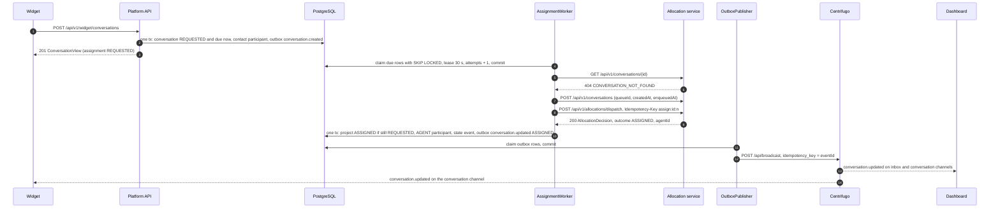

# Conversation platform: allocation service integration

Design document (master spec 11.1, 11.4, 13). Plan 04 implements it: the `assignment` module holds
`AllocationClient` and `AllocationSeeder`; the `conversation` module holds `AssignmentWorker`, `AssignmentOrchestrator`,
the projection, `/assign` and the presence endpoints (D2); Compose gains the engine. Conventions (Existing, `D<n>`,
`R<n>`, `R-P<n>`): [system-overview.md](system-overview.md) section 0. Decision record: [ADR-0009](../../specs/decisions/ADR-0009-allocation-service-integration.md). Engine facts,
the call table (ids S1 to S10, P1, P2, V1 to V4, A1 to A3, H1, O1 to O4) and the full failure matrix (F1 to F15) are in
[allocation-service-integration.md](../research/allocation-service-integration.md); read its section 1 ("what bites")
before changing anything here.

**Existing:** the platform has no allocation client today (`grep -rni allocation` over the platform finds nothing;
[workspace-inventory.md](../research/workspace-inventory.md) section 8.1, boundary 6); the demo hard-codes
`assigned_agent_id = agentbob`. The engine is a separate Maven project with its own PostgreSQL, REST under `/api/v1`,
header auth (`X-Tenant-Id`, `X-Role`, `Idempotency-Key`), a fixed-delay dispatch sweep and no Dockerfile.

## 1. Topology (D8)

| Container (Compose base file, Plan 04 T1) | Image | Host port → container | Key settings |
|---|---|---|---|
| `allocation-postgres` | `postgres:18.6-alpine3.24`, volume `allocation-postgres-data` | `127.0.0.1:5433` → 5432 (`ALLOCATION_DB_HOST_PORT`) | `POSTGRES_DB=allocation`, `POSTGRES_USER=allocation`, `POSTGRES_PASSWORD=${ALLOCATION_DB_PASSWORD}` (`__generate__` in `.env.example`); `pg_isready` health |
| `allocation-service` | `chat-platform/allocation-service:local`, built from `${ALLOCATION_ENGINE_DIR:-../RESEARCH/Allocationservice-research/allocation-engine}` with its new `Dockerfile` | `127.0.0.1:8081` → 8080 (`ALLOCATION_HOST_PORT`) | `ALLOCATION_DB_URL=jdbc:postgresql://allocation-postgres:5432/allocation`, `ALLOCATION_BIND_ADDRESS=0.0.0.0`, `ALLOCATION_FEATURE_LEVEL=operations`, `ALLOCATION_SEED_DEMO=false`, `ALLOCATION_DISPATCHER_ENABLED=true`, `ALLOCATION_DISPATCHER_DELAY=2s` (engine default 5 s), `ALLOCATION_UI_DIST=classpath:/static/`; depends on a healthy database; health `GET /actuator/health` |

- The engine is unchanged apart from an added `Dockerfile`, `.dockerignore` and one README line, uncommitted like the
  rest of that project (D8, D20). It runs its own Flyway V1 to V5 at start.
- The platform reaches it at `app.allocation.url` (`ALLOCATION_URL`): `http://localhost:8081` from the host,
  `http://allocation-service:8080` from containers; timeout `app.allocation.timeout=3s`.
- Feature level `operations` is required: claim, reassign and requeue answer 403 `FEATURE_DISABLED` below it.
- Demo seeding stays off: the engine's sweep covers every tenant, and a request without `X-Tenant-Id` silently falls back
  to `demo-tenant`.
- CI limitation: the `e2e` job runs only when the engine checkout exists as a sibling directory and otherwise reports
  the skip (Plan 04 T1).

Identifier mapping:

| Allocation concept | Platform value |
|---|---|
| tenant (`X-Tenant-Id`) | our tenant id |
| conversation id | our conversation UUID as text |
| queue id | `inboxes.allocation_queue_id` (seed: `support`) |
| agent id | our agent id (`agents.id`) |
| role (`X-Role`) | `operator`; `admin` for seeding |
| correlation (`X-Correlation-Id`) | the request or worker trace id |

There is no cross-service transaction. The platform's conversation row is the durable request; the allocation service
is the authority on assignments, availability and capacity; the platform stores a projection (D8).

## 2. Assignment of a new conversation



No allocation call happens inside a transaction or under a row lock: the claim commits first, the calls run, and the
projection is a new short transaction whose `UPDATE` carries an `assignment_state` precondition (0 rows: the row moved
on, the result is dropped; R13). The engine's own sweep may assign a waiting conversation without being asked and
without telling anyone, which is why the worker reads before it writes and polls `QUEUED` rows.

## 3. Worker algorithm per `assignment_state`

The state machine itself is in [domain-model.md](domain-model.md) section 6. `AssignmentWorker.runOnce()` claims a
bounded batch, commits, then `AssignmentOrchestrator` processes each row outside the claim transaction:

```sql
UPDATE conversations
   SET assignment_next_attempt_at = :now + :lease, assignment_attempts = assignment_attempts + 1
 WHERE id IN (SELECT id FROM conversations
               WHERE ((assignment_state IN ('REQUESTED', 'QUEUED') AND archived_at IS NULL)
                      OR assignment_state IN ('RELEASE_PENDING', 'REOPEN_PENDING'))
                 AND assignment_next_attempt_at <= :now
               ORDER BY assignment_next_attempt_at
               LIMIT :limit
               FOR UPDATE SKIP LOCKED)
RETURNING …
```

The index is `ix_conversations_assignment_due`. The worker never dispatches an archived row (R-P13): archiving moves
`REQUESTED` and `QUEUED` rows to `RELEASE_PENDING`, and the claim excludes archived `REQUESTED`/`QUEUED` rows as a
second guard. A claim is worker bookkeeping and does not change `version` (R-P9).

| Claimed state | Call | Allocation answer | New state (event) |
|---|---|---|---|
| `REQUESTED` | `findConversation` (V2) | absent | `createConversation` (V1; 409 `CONVERSATION_EXISTS`/`CONFLICT` = success) then `dispatch` (A1) → outcome table below |
| | | `QUEUED` | `dispatch` (A1) → outcome table |
| | | `ASSIGNED`, `ACCEPTED`, `ACTIVE` | `ASSIGNED`, agent from the record, `decisionId` null, reason `ALLOCATION_SWEEP` (event `ASSIGNED`) |
| | | `RESOLVED` | `requeueReopen` (V4), stays `REQUESTED`, due now (R-P10) |
| | | `CANCELLED` | `FAILED`, reason `ALLOCATION_CANCELLED` (event `ASSIGNMENT_FAILED`); the platform never cancels, so this is an alert (R-P10) |
| `QUEUED` | `findConversation` only: `QUEUED` rows poll and never dispatch (R-P1) | `ASSIGNED`, `ACCEPTED`, `ACTIVE` | `ASSIGNED`, reason `ALLOCATION_SWEEP` (event `ASSIGNED`) |
| | | `QUEUED` | stays `QUEUED`, next poll in `queued-poll` (5 s); no event |
| | | absent | `REQUESTED` (the allocation side lost the record, F2: alert) |
| | | `RESOLVED` / `CANCELLED` | as for `REQUESTED` |
| `RELEASE_PENDING` | `resolve` (V3) | 200 | `NONE`, agent and decision cleared (state event `RELEASED`, no realtime event) |
| | | 404 `CONVERSATION_NOT_FOUND` or 409 `CONVERSATION_CLOSED` | confirm with `findConversation` (research section 1, item 6): `RESOLVED`, `CANCELLED` or absent → `NONE` as above; any other status → stays `RELEASE_PENDING` with backoff and a WARN log |
| `REOPEN_PENDING` | `findConversation` | absent | `REQUESTED` |
| | | `RESOLVED` | `requeueReopen` (V4 `{reason: REOPEN, excludePreviousAgent: false}`; 409 `INVALID_REQUEUE` counts as done only if a `findConversation` shows `QUEUED`) → `REQUESTED` |
| | | `ASSIGNED`, `ACCEPTED`, `ACTIVE` (the release never reached the engine) | `ASSIGNED`, same agent, reason `REOPEN_KEPT_AGENT` (event `ASSIGNED`) |
| | | `QUEUED` | `QUEUED` (event `ASSIGNMENT_QUEUED`) |
| | | `CANCELLED` | `FAILED` |

Engine errors, for every claimed state (R-P2, R-P14, R-P15):

| Error | Platform reaction |
|---|---|
| `AllocationUnavailableException` (connect or read timeout, 5xx) | state unchanged, `next = Backoff.next(now, attempts − 1, poll-delay, max-backoff, rng)`; no event |
| 409 `CONCURRENT_MODIFICATION`, 409 `IDEMPOTENCY_RACE` | transient: as unavailable. The next attempt uses the next key; the engine's conversation lock and one-active-assignment index make a repeated dispatch safe. |
| 404 `TENANT_NOT_FOUND`, 404 `QUEUE_NOT_FOUND`, 409 `NO_ACTIVE_POLICY` (allocation side not seeded yet) | `assignment_setup_failures + 1`, state unchanged, backoff; at `max-setup-attempts` (30) → `FAILED` with that code (overview §7 B). `RELEASE_PENDING` only backs off. |
| any other 4xx (`FEATURE_DISABLED`, `IDEMPOTENCY_KEY_REUSED`, `INVALID_ID`, …) on `REQUESTED`, `QUEUED`, `REOPEN_PENDING` | `FAILED` with the code (event `ASSIGNMENT_FAILED`), WARN log (R-P10) |
| any other 4xx on `RELEASE_PENDING` | stays `RELEASE_PENDING` with backoff and a WARN log carrying the code; never `FAILED`, because the capacity must eventually be released |
| any successful engine response | `assignment_setup_failures = 0` |

Dispatch outcome table (A1; also used by `/assign`, section 5). Branch on `outcome`, never on HTTP 200:

| Outcome | Worker | `/assign` answer |
|---|---|---|
| `ASSIGNED` | `ASSIGNED`: agent, `decisionId`, reason, explanation (event `ASSIGNED`) | 200 view, `assignment.state = ASSIGNED` |
| `QUEUED_NO_ELIGIBLE_AGENT`, `QUEUED_CAPACITY_EXHAUSTED`, `QUEUED_NO_AVAILABLE_AGENT`, `QUEUED_MANUAL_SELECTION`, `QUEUED_FEATURE_DISABLED` | `QUEUED`, reason = outcome, next poll in 5 s (event `ASSIGNMENT_QUEUED` on entering `QUEUED`). The last two need an operator or a claim; they stay visible. | 200 view, `assignment.state = QUEUED` with the reason (overview §7 F) |
| `CONFLICT_RETRYABLE` (not stored by the engine) | stays `REQUESTED`, due after `poll-delay`; the next attempt dispatches with the next key (R-P1) | 409 `ALLOCATION_REJECTED`, detail `CONFLICT_RETRYABLE`: retry with the same `Idempotency-Key` (R-P10) |
| `REJECTED_INVALID_INPUT` + `CONVERSATION_NOT_ALLOCATABLE` | reconcile: `findConversation`; assigned → `ASSIGNED` (`ALLOCATION_SWEEP`), anything else → `FAILED` | 409 `ALLOCATION_REJECTED`, projection unchanged (`AssignmentApiIT.doubleClaimIsRejectedConsistently`) |
| `REJECTED_INVALID_INPUT` with another reason (on a claim typically `AGENT_NOT_FOUND`: the claimer is not in the conversation's queue) | `FAILED`, reason = outcome (event `ASSIGNMENT_FAILED`) | 409 `ALLOCATION_REJECTED`, projection unchanged (R-P14) |
| `CLAIM_REJECTED` (claim only) | n/a | 409 `ALLOCATION_REJECTED` with `reasonCodes`, projection unchanged (R-P14) |
| `FAILED_INTERNAL`, `SKIPPED_POLICY_DISABLED`, `NO_WAITING_CONVERSATION` | `FAILED`, reason = outcome (event `ASSIGNMENT_FAILED`) | `FAILED` projection, 409 `ALLOCATION_REJECTED` |

Visibility (R-P3): the projection's `decisionId`, `reason` and `explanation` are internal routing data. Contact callers
and every `conversation.created`/`conversation.updated` payload see only `assignment.state` and `assignment.agentId`;
the dashboard reads the rest with `GET /api/v1/agent/conversations/{id}` when an event changes the open conversation.

**Limitation (R-P14):** `ASSIGNED` rows are not claimed, so nothing reconciles them in the background in the MVP. A
change made directly in the allocation service (its workbench or API: a requeue, reassign or resolve there) is not
reflected in the platform until a platform command touches the conversation.

## 4. Idempotency keys and timing

- **Worker:** `Idempotency-Key: assign:<conversationId>:<attempt>`, where `<attempt>` is the `assignment_attempts`
  value returned by the claim. `assignment_attempts` only grows (it is never reset; setup errors are counted
  separately in `assignment_setup_failures`, R-P2), so every dispatch gets a key that was never used, and only
  `REQUESTED` rows dispatch (R-P1). The key is at most 7 + 36 + 1 + 10 characters (limit 128).
- **Deviation from research F1, F7 and F13**, which retry "with the same key": the worker uses a new key on every
  attempt, including the retry after a timeout or a lost response. This is deliberate and safe; Plan 04 must not change
  it back. A repeated dispatch with a new key cannot assign twice: the engine locks the conversation row, updates it only
  while it is `QUEUED`, and keeps one active assignment per conversation (unique index
  `assignment_one_active_per_conversation`), so the second request answers `CONVERSATION_NOT_ALLOCATABLE`, which the
  worker reconciles by reading the record. Reusing a key is the unsafe direction: the engine replays a stored decision
  for ever, so a stale "queued" or "rejected" answer would come back in a later allocation cycle (research section 1,
  item 2, and section 5.2). Cost: one engine idempotency record and decision row per dispatch attempt.
- **`/assign`:** the dashboard's `Idempotency-Key` header (required, 1 to 128 characters, else 400
  `VALIDATION_FAILED`), passed through unchanged. One click is one key; a retry of the same click reuses it and gets the
  stored decision; a second click with a new key on an assigned conversation is 409.
- Worker keys (`assign:` prefix) and dashboard keys (random UUIDs) never coincide, so the engine's
  `IDEMPOTENCY_KEY_REUSED` cannot be triggered by design.

| Setting | Value | Use |
|---|---|---|
| `app.assignment.enabled` (`APP_ASSIGNMENT_ENABLED`) | `true` | gates only the scheduled tick; tests call `runOnce()` |
| `app.assignment.poll-delay` | 2 s | tick interval; retry after `CONFLICT_RETRYABLE`; backoff base |
| `app.assignment.queued-poll` | 5 s | fixed poll interval of `QUEUED` rows (overview §7 C) |
| `app.assignment.lease` | 30 s | claim lease; a crashed worker's rows return after it |
| `app.assignment.max-backoff` | 60 s | cap for error backoff (jitter before the cap) |
| `app.assignment.max-setup-attempts` | 30 | `assignment_setup_failures` that make a row `FAILED` (R-P2) |
| `app.allocation.timeout` | 3 s | per HTTP call |
| engine `ALLOCATION_DISPATCHER_DELAY` | 2 s in Compose | the engine's own sweep of waiting conversations |
| policy `heartbeatTtlSeconds` = `app.presence.stale-after` | 60 s | presence freshness, both sides equal |

Backoff (R-P15): `outbox.Backoff.next(now, n, base, max, rng) = now + min(base × 2^n ± 20 %, max)` with a 0-based
`n`; the worker passes `n = attempts − 1`, `base = poll-delay`, `max = max-backoff`. Because `assignment_attempts` is
monotonic, a row that has already been polled many times backs off at the 60 s cap on its first error.

With these values a sweep assignment is projected within about 7 s (2 s sweep + 5 s poll), and the dashboard sees it
after the next outbox publication (about 0.5 s).

## 5. Manual assignment: `POST /api/v1/agent/conversations/{id}/assign`

Body `AssignRequest(mode, expectedVersion)`, header `Idempotency-Key`, agent of the conversation's tenant.

| Mode | Engine call | Meaning |
|---|---|---|
| `CLAIM` | `claim(tenant, key, id, caller.principalId())` (A2) | "Assign to me" (`action-assign-me`) |
| `AUTO` | `dispatch(tenant, key, id)` (A1) | run the policy now (`action-auto-assign`) |
| `REASSIGN` | `reassign(tenant, key, id)` (A3) | release the current agent and allocate again; the previous agent is always excluded, so a single-agent tenant ends `QUEUED` (`action-reassign`) |

Order:
1. Participant and tenant check (403); archived or `RESOLVED` → 409 `INVALID_TRANSITION`; `expectedVersion`, when
   present and different → 409 `STALE_VERSION` (R-P10).
2. If `assignment_state` is `REQUESTED` or `FAILED`, `createConversation` first (the record may not exist).
3. Call the engine outside any transaction and handle the outcome with the table of section 3.
4. `NOT_ASSIGNED` on `REASSIGN` (the engine holds no active assignment): `findConversation` and project what the engine
   holds (`ASSIGNED`/`ACCEPTED`/`ACTIVE` → `ASSIGNED` with that agent, `QUEUED` → `QUEUED`, absent or `RESOLVED` →
   `REQUESTED` for the worker, `CANCELLED` → `FAILED`), then answer 409 `ALLOCATION_REJECTED` with detail
   `NOT_ASSIGNED` (R-P14).
5. `AllocationUnavailableException` → 503 `ALLOCATION_UNAVAILABLE`; any other engine rejection → 409
   `ALLOCATION_REJECTED` with the engine code in `detail`, projection unchanged.
6. Success answers with the agent `ConversationView` (full assignment).

## 6. Presence and availability (D9, master spec 11.1)

| Meaning | Source | Shown as |
|---|---|---|
| Connected | the client's Centrifugo socket state; not stored | dashboard `connection-state` badge |
| Available | allocation `agent.status` (`ONLINE`, `AWAY`, `OFFLINE`) plus a heartbeat no older than 60 s | dashboard `availability-select`; widget `agent-presence` |
| Capacity | counted by the engine from its active assignments (local policy: 3 per agent) | not shown; explains `QUEUED_CAPACITY_EXHAUSTED` |
| Assigned | the projection on `conversations` | dashboard `assignment-state` |

- `PUT /api/v1/agent/presence` `{availability}` → `AllocationClient.presence(tenantId, agentId, status)` (P1 with body
  `{status}` and no `heartbeatAt`: the engine stamps its own clock, so a host/container clock skew cannot cause 400
  `TIMESTAMP_IN_FUTURE`; R-P4) → `{agentId, tenantId, displayName, availability, lastHeartbeatAt}`; 503
  `ALLOCATION_UNAVAILABLE` when the engine is down (the dashboard keeps its 30 s heartbeat, which repairs any missed
  forward). `GET /api/v1/agent/me` reads the same view.
- The dashboard sends the heartbeat on every change and every 30 s; two missed beats make the agent stale for new
  allocations.
- Nothing is released when an agent goes offline or stale: the engine has no such rule (F15) and the platform adds none
  in the MVP. A disconnected browser never changes an assignment (master spec 11.1).
- `ConversationView.agentOnline` (contact callers only): if the conversation is assigned, whether that agent is
  `ONLINE` with a fresh heartbeat; if not, whether any enabled agent of the tenant is; `null` when the engine is
  unavailable. `GET /api/v1/agents` is cached per tenant for 5 s (`ponytail:` note). The widget refreshes it on
  `conversation.updated` and every 30 s.
- The platform keeps no second availability store (D9).

## 7. Failure handling: platform reactions to research section 7.2

Rows marked **deviation** differ from the research recommendation on purpose (section 4).

| # | Situation | Platform behaviour |
|---|---|---|
| F1 | Engine down, restarting, timing out, 5xx | worker keeps the state and backs off (up to 60 s), next attempt with the next key (**deviation**: research retries with the same key); `/assign` and presence 503; chat unaffected; status `allocation` DOWN |
| F2 | Tenant missing (engine database reset or never seeded) | `assignment_setup_failures` backoff, `FAILED` at 30, while `AllocationLocalSeeder` or the admin tenants endpoint re-seeds; `RELEASE_PENDING` keeps retrying; a record lost from a `QUEUED` row returns to `REQUESTED` |
| F3, F3b | Queue or policy missing | as F2, then `FAILED` with `QUEUE_NOT_FOUND` / `NO_ACTIVE_POLICY` |
| F4 | `CONVERSATION_EXISTS` on create | success |
| F5 | `NOT_ASSIGNED` on reassign | `/assign` reads the engine record, projects it and answers 409 (section 5). `ASSIGNED` rows are not reconciled in the background in the MVP (limitation, section 3). |
| F6, F6b | `INVALID_REQUEUE`, `CONVERSATION_CLOSED` (and 404 on resolve) | done only after `findConversation` confirms the state (section 3) |
| F6c | `FEATURE_DISABLED` | `FAILED` (`RELEASE_PENDING`: backoff and WARN); fix `ALLOCATION_FEATURE_LEVEL=operations` |
| F7 | `CONFLICT_RETRYABLE` | stays `REQUESTED`, retried on the next tick with the next key (**deviation**: the outcome is not stored, so a new key is as safe as the same one); `/assign` 409 with a retry hint |
| F8 | `QUEUED_*` | `QUEUED` and poll; no re-dispatch (R-P1) |
| F9 | `QUEUED_FEATURE_DISABLED`, `SKIPPED_POLICY_DISABLED`, `FAILED_INTERNAL` | `QUEUED` (visible) or `FAILED`; operator fixes the policy, then `/assign` |
| F10 | `REJECTED_INVALID_INPUT` | worker: reconcile for `CONVERSATION_NOT_ALLOCATABLE`, else `FAILED`; `/assign`: 409, projection unchanged |
| F11 | `CLAIM_REJECTED` | 409 to the agent with `reasonCodes`, projection unchanged |
| F12 | `IDEMPOTENCY_KEY_REUSED`; `IDEMPOTENCY_RACE` | the first cannot happen by key design (`FAILED` and WARN if it does); the second is transient (backoff) |
| (A3, V3, V4) | `CONCURRENT_MODIFICATION` | transient: backoff, next attempt (R-P14) |
| F13 | Response lost | the next attempt uses the next key (**deviation**) and reconciles through the read-first step; resolve and requeue are confirmed by a read |
| F14 | Engine rejects our data (`INVALID_ID`, …) | `FAILED` with the code, a bug (`RELEASE_PENDING`: backoff and WARN). `TIMESTAMP_IN_FUTURE` cannot occur: presence sends no timestamp (R-P4) |
| F15 | Agent goes offline with assignments | nothing happens by design |

## 8. Seeding

- `AllocationSeeder.ensureTenant(tenantId, tenantName, queueId, agents)` (role `admin`, every step safe to repeat):
  `POST /tenants` → `GET /queues`, create the queue if missing → per agent `GET /agents/{id}` and, only on 404,
  `POST /agents` with `memberships: [{queueId}]`, `maxActiveAssignments`, `status: OFFLINE`, `enabled: true` (an
  existing agent is never re-posted: the call is a full replace that would reset its live status) → `GET
  /policies/local-round-robin`, on 404 `POST /policies` with the FIFO + round-robin + count-based (3) + keep-queued
  definition, every field present (`enabled: true`, `maxTraceCandidates: 200`, `heartbeatTtlSeconds: 60`) → publish
  unless already published. The exact body is in Plan 04 T2.
- `AllocationLocalSeeder` (local profile, after the tenancy seeder) runs `ensureTenant("tenant-local", "Local tenant",
  "support", [SeedAgent("agentbob", "Agent Bob", 3)])` on a virtual thread, retrying every 10 s for up to 5 minutes
  while the engine is unavailable; it never blocks startup.
- `POST /api/v1/admin/tenants` (Plan 05 T2) seeds both sides for other tenants (load tests).
- **Limitation (R-P12):** one inbox (queue) per tenant in MVP seeding and in the load harness; the tenant's policy
  `local-round-robin` lists that one queue (overview §5). A second inbox needs the policy's `queueIds` extended and
  republished, or one policy per queue as the research recommends (section 7.3 there).

## 9. Health, metrics, upgrade path

- `GET /api/v1/status` gains `allocation` from `AllocationClient.healthy()`: true only for `GET /api/v1/health` 200 with
  `status = UP` (the engine answers 200 `DEGRADED` when its database is down).
- Timer `allocation.requests{operation, outcome}`; every call carries `X-Correlation-Id`.
- No webhook: the engine makes no outbound call and has no notification hook, so polling is the only mechanism today.
  An engine-side `afterCommit` notification is the additive upgrade path; it and its trigger are recorded in ADR-0009.
